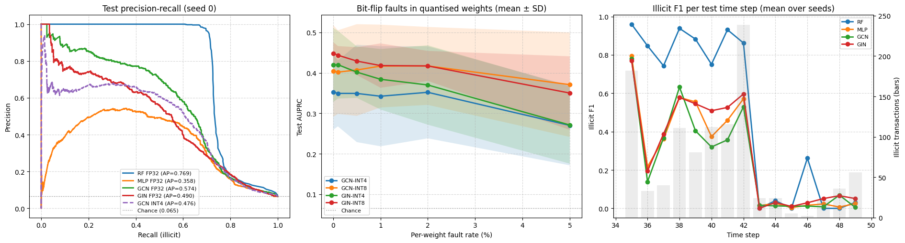

# Efficiency and Fault Robustness of GNNs for Illicit Bitcoin Transaction Detection (Elliptic)

This repository contains a leakage-checked, multi-seed benchmark of graph neural networks (GCN, GIN) and non-graph baselines (logistic regression, random forest, MLP) on the Elliptic Bitcoin transaction graph. It also evaluates how simulated low-precision weights, magnitude pruning and single-bit-flip faults change detection performance.

The aim is a careful evaluation, not a new state-of-the-art model. The results are reported as they came out, including findings that go against the GNNs.

## Main findings

1. **A random forest outperformed both GNNs in this setup.**
   - AUPRC: random forest 0.770 ± 0.003, GIN 0.451 ± 0.026, GCN 0.405 ± 0.112 (5 seeds).
   - Illicit F1 of the random forest (0.781) is close to the 0.788 reported by Weber et al. (2019), which supports the correctness of the evaluation pipeline.
2. **GIN benefits from the graph; GCN shows no reliable benefit.**
   - GIN exceeded a matched graph-free MLP in AUPRC in all five seeds (+0.104 ± 0.027). The gain did not extend to AUROC (−0.010 ± 0.016).
   - The difference between GCN and the MLP was inconsistent across seeds (+0.058 ± 0.101, 3/5 seeds), and GCN varied widely between seeds (AUPRC 0.280–0.574).
3. **INT8 weights caused no measurable loss; INT4 weights did.**
   - INT8: |ΔAUPRC| ≤ 0.003 for all models.
   - INT4: GCN −0.053 ± 0.038 (worse in 4/5 seeds), GIN −0.031 ± 0.079, MLP −0.027 ± 0.030.
   - A single-seed run had suggested that INT4 improved GCN. With five seeds this was not reproduced.
4. **Bit-flip faults: INT8 tolerated faults better than INT4.**
   - Up to a 2% per-weight fault rate, the mean AUPRC of the INT8 models stayed within 7% of the fault-free value.
   - At 5%, mean AUPRC fell by 8–22% for INT8 and by 23–35% for INT4, with large variation between fault patterns.
   - At rates of 1% or below, the effect of the faults was smaller than the variation between training seeds.
5. **All models failed after time step 43**, the dark-market shutdown described by Weber et al. (2019).

## Set-up

| Item | Setting |
|---|---|
| Data | Elliptic (203,769 transactions, 234,355 edges, 46,564 labelled, 4,545 illicit), 165 features; `txId` and `time_step` excluded |
| Split | Temporal: train t1–28, validation t29–34, test t35–49. No edge connects different time steps (checked in the notebook). Illicit share: 10.1% / 19.6% / 6.5% |
| Graph | All nodes and undirected edges are used for message passing; loss and metrics use labelled nodes only |
| Neural models | MLP, GCN and GIN with 2 layers, hidden size 128, dropout 0.3, BatchNorm, 120 epochs, Adam, BCE loss with pos_weight = sqrt(neg/pos), checkpoint chosen by validation AUPRC. The MLP has the same depth and width as the GCN and ignores the edges |
| Baselines | Random forest (100 trees, max_features = 50); logistic regression (standardised features) |
| Seeds | 5 training seeds per model; comparisons paired by seed |
| Threshold | Tuned on validation to maximise illicit F1, then applied unchanged to test |
| Metrics | AUPRC (primary), AUROC, illicit F1 (at 0.5 and at the validation threshold), precision, recall, top-label ECE, Brier score |
| Quantisation | Simulated, weight-only, post-training, symmetric per-tensor INT8/INT4. Weights are rounded and then stored back in FP32 ("fake quantisation"). Biases, BatchNorm parameters and activations stay in FP32 |
| Pruning | One-shot magnitude pruning per weight matrix (50%, 80%), without fine-tuning |
| Faults | Each quantised weight is hit with probability *p* (0.1–5%); a hit flips one uniformly chosen bit of its integer code. 5 models × 3 fault seeds per setting |
| Hardware | One NVIDIA L4 GPU; full run about 3 minutes |

## Results

**Test set (t35–49), FP32, mean ± SD over 5 seeds** (logistic regression is deterministic: 1 run)

| Model | AUROC | AUPRC | Illicit F1 (validation threshold) | ECE | Brier |
|---|---|---|---|---|---|
| Logistic regression | 0.877 | 0.265 | 0.280 | 0.176 | 0.202 |
| Random forest | 0.899 ± 0.004 | **0.770 ± 0.003** | **0.781 ± 0.016** | 0.073 ± 0.006 | 0.034 ± 0.000 |
| MLP | 0.846 ± 0.004 | 0.347 ± 0.018 | 0.379 ± 0.040 | 0.233 ± 0.028 | 0.289 ± 0.024 |
| GCN | 0.825 ± 0.025 | 0.405 ± 0.112 | 0.315 ± 0.063 | 0.305 ± 0.085 | 0.348 ± 0.076 |
| GIN | 0.836 ± 0.012 | 0.451 ± 0.026 | 0.444 ± 0.032 | 0.239 ± 0.092 | 0.284 ± 0.064 |

**Change in AUPRC after compression, relative to FP32** (paired by seed; seeds worse than FP32 in brackets)

| Model | INT8 | INT4 | Pruned 50% | Pruned 80% |
|---|---|---|---|---|
| MLP | +0.001 ± 0.004 (3/5) | −0.027 ± 0.030 (4/5) | −0.034 ± 0.037 (5/5) | −0.146 ± 0.074 (5/5) |
| GCN | −0.001 ± 0.004 (3/5) | −0.053 ± 0.038 (4/5) | −0.041 ± 0.019 (5/5) | −0.149 ± 0.114 (4/5) |
| GIN | −0.003 ± 0.005 (3/5) | −0.031 ± 0.079 (3/5) | −0.069 ± 0.084 (4/5) | −0.188 ± 0.108 (5/5) |

**Test AUPRC under bit-flip faults in quantised weights** (mean ± SD; 15 runs per faulty setting; chance level 0.065)

| Per-weight fault rate | GCN-INT8 | GCN-INT4 | GIN-INT8 | GIN-INT4 |
|---|---|---|---|---|
| 0 | 0.405 ± 0.114 | 0.353 ± 0.093 | 0.448 ± 0.028 | 0.419 ± 0.092 |
| 0.1% | 0.402 ± 0.103 | 0.349 ± 0.082 | 0.444 ± 0.023 | 0.420 ± 0.084 |
| 0.5% | 0.407 ± 0.113 | 0.349 ± 0.120 | 0.429 ± 0.034 | 0.402 ± 0.064 |
| 1% | 0.417 ± 0.102 | 0.342 ± 0.124 | 0.418 ± 0.055 | 0.384 ± 0.075 |
| 2% | 0.417 ± 0.096 | 0.352 ± 0.114 | 0.417 ± 0.037 | 0.370 ± 0.098 |
| 5% | 0.371 ± 0.129 | 0.270 ± 0.099 | 0.350 ± 0.091 | 0.271 ± 0.096 |

All per-run values are in [`results/`](results/).

## Limitations

- **Under-tuned neural models.** The GCN and MLP reach a much lower illicit F1 than reported by Weber et al. (2019): 0.315 vs 0.628 for GCN and 0.379 vs 0.653 for MLP. Part of the gap comes from the shorter training period here (t1–28 vs t1–34). The comparison with the random forest should therefore be read as "in this set-up", not as a general ranking of model families.
- **Poorly calibrated probabilities.** The neural models assign high scores to many licit test transactions: Brier score 0.28–0.35, and validation thresholds of 0.85–0.95. A plausible but untested cause is a shift in feature distributions over time.
- **Prior shift between splits** (illicit share 10.1% / 19.6% / 6.5%) affects thresholds, F1 and calibration.
- **Fault rates are a stress test.** They are far above realistic hardware soft-error rates, and they are per-weight rates, not per-bit error rates.
- **Quantisation is simulated.** No speed-up or memory saving was measured.
- **Scope.** One dataset, one temporal split and five seeds; hyperparameters were not tuned per model.

## How to run

1. Open `Elliptic_GNN_Robust_Evaluation_v2.ipynb` in Google Colab and select a GPU runtime.
2. Choose *Run all*.
   - The dataset is downloaded from Kaggle with `kagglehub`; the PyTorch Geometric mirror is used as a fallback.
   - Alternatively, put the three CSV files in a folder and set `CONFIG["data_dir"]`.
3. The tables, figures and `config.json` are written to `results/`.

Tested with torch 2.14.1, torch_geometric 2.8.1 and scikit-learn 1.6.1 (see `requirements.txt`).

## Data

The Elliptic dataset is not redistributed here. It is available on Kaggle as [`ellipticco/elliptic-data-set`](https://www.kaggle.com/datasets/ellipticco/elliptic-data-set).

## Reference

Weber, M., Domeniconi, G., Chen, J., Weidele, D. K. I., Bellei, C., Robinson, T., & Leiserson, C. E. (2019). *Anti-Money Laundering in Bitcoin: Experimenting with Graph Convolutional Networks for Financial Forensics.* KDD Workshop on Anomaly Detection in Finance. [arXiv:1908.02591](https://arxiv.org/abs/1908.02591)

## Author

Mehar Ali, github.com/Mehar-Ali1122
